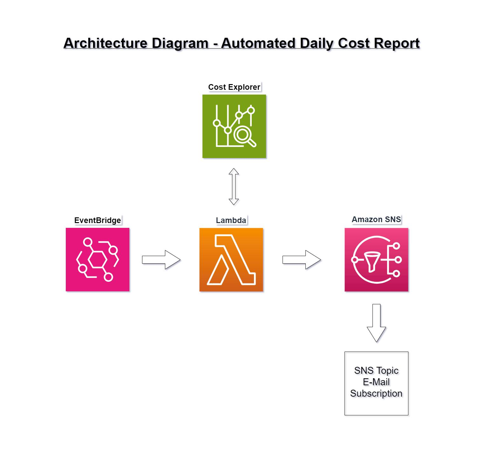
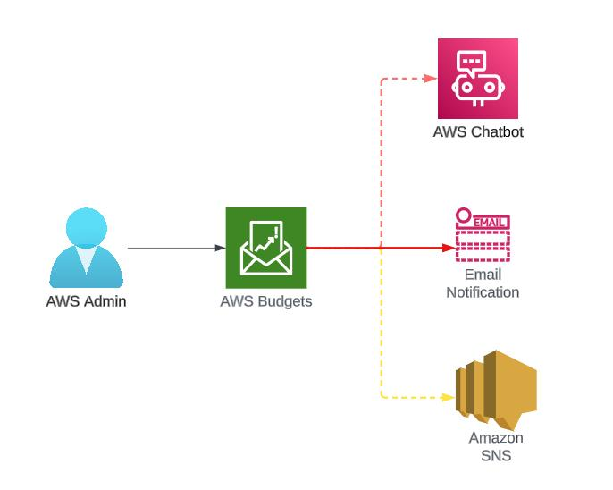
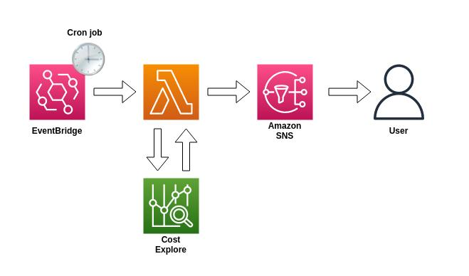
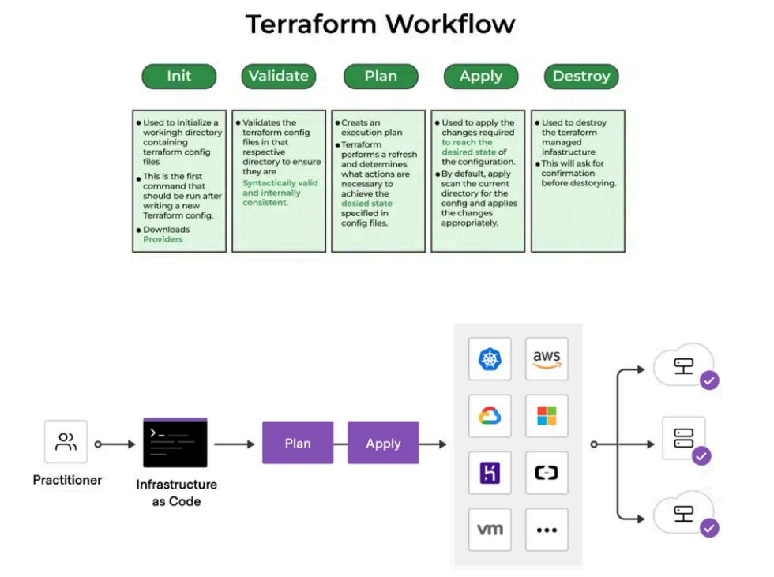

# AWS Cloud Cost Monitoring & Budget Alert System

An automated AWS cost monitoring and alerting solution built using **Terraform, AWS Budgets, Amazon SNS, Amazon CloudWatch, AWS Lambda, Amazon EventBridge, and AWS Cost Explorer**.

The project helps monitor monthly AWS spending, generate automated cost reports, and notify users through email when configured budget thresholds are reached.

---

## 1. Project Overview

Managing cloud costs is an important part of operating infrastructure on AWS. Without proper monitoring, unexpected resource usage can increase monthly cloud expenses.

This project implements an automated cost monitoring solution that:

- Creates a monthly AWS budget of **$5 USD**.
- Sends email alerts when actual spending reaches 50%, 80%, and 100% of the budget.
- Uses Amazon CloudWatch to monitor estimated AWS charges.
- Uses AWS Lambda to generate monthly-to-date cost reports.
- Uses Amazon EventBridge to schedule daily cost reports.
- Uses Amazon SNS to deliver email notifications.
- Uses Terraform to provision and manage AWS infrastructure.

## 2. AWS Architecture

The following diagram illustrates the overall architecture and how the AWS services interact.



### Architecture Components

| AWS Service | Purpose |
|---|---|
| AWS Budgets | Tracks monthly AWS spending and budget thresholds |
| Amazon SNS | Sends email notifications and cost reports |
| Amazon CloudWatch | Monitors estimated AWS charges |
| AWS Lambda | Retrieves and generates AWS cost reports |
| Amazon EventBridge | Triggers the Lambda function daily |
| AWS Cost Explorer | Provides AWS cost and usage information |
| Terraform | Automates AWS infrastructure provisioning |

## 3. Technologies Used

- **Cloud Platform:** Amazon Web Services (AWS)
- **Infrastructure as Code:** Terraform
- **Programming Language:** Python
- **Monitoring:** Amazon CloudWatch
- **Notifications:** Amazon SNS
- **Cost Management:** AWS Budgets and AWS Cost Explorer
- **Serverless Computing:** AWS Lambda
- **Scheduling:** Amazon EventBridge
- **Version Control:** Git and GitHub
- **Operating System:** Ubuntu Linux

## 4. Project Structure

```text
AWS-Cloud-Cost-Calculator/
│
├── README.md
│
├── docs/
│   ├── images/
│   │   ├── architecture.jpg
│   │   ├── budget-alert-workflow.jpg
│   │   ├── daily-report-workflow.jpg
│   │   └── terraform-workflow.jpg
│   │
│   └── screenshots/
│
├── lambda/
│   ├── cost_report.py
│   └── requirements.txt
│
├── scripts/
│   ├── cleanup.sh
│   └── deploy.sh
│
└── terraform/
    ├── main.tf
    ├── provider.tf
    ├── versions.tf
    ├── variables.tf
    ├── terraform.tfvars
    ├── outputs.tf
    ├── sns.tf
    ├── lambda.tf
    └── cloudwatch.tf
```

**Note:** Terraform state files, local variable files, generated ZIP packages, and other sensitive or local-only files should be excluded from Git using `.gitignore`.

## 5. AWS Budget Alert Workflow

AWS Budgets monitors monthly spending against a configured budget of $5 USD.

Three actual-cost notification thresholds are configured:

- 50% — Budget usage reaches $2.50.
- 80% — Budget usage reaches $4.00.
- 100% — Budget usage reaches $5.00.

When a threshold is reached, AWS Budgets publishes a notification to the configured SNS topic, which delivers an email alert to the subscribed email address.



### Notification Flow

1. AWS Budgets monitors monthly AWS spending.
2. Actual spending is compared with the configured budget thresholds.
3. When a threshold is reached, AWS Budgets generates a notification.
4. Amazon SNS receives the notification.
5. SNS delivers an email alert to the confirmed subscriber.

## 6. Automated Daily Cost Reporting

AWS Lambda automatically retrieves month-to-date AWS spending information using the AWS Cost Explorer API.

An Amazon EventBridge rule triggers the Lambda function once every day using:

```text
rate(1 day)
```

The Lambda function:

1. Retrieves month-to-date AWS cost information.
2. Groups costs by AWS service.
3. Calculates total spending.
4. Calculates remaining budget and budget utilization.
5. Identifies the top three services by cost.
6. Generates a formatted cost report.
7. Publishes the report through Amazon SNS.



### Sample Cost Report

```text
AWS CLOUD COST REPORT

Reporting Period: Month to Date

Monthly Budget: $5.00
Total Spending: $0.00
Remaining Budget: $5.00
Budget Utilization: 0%

Top Services:
- No service costs returned for this period.

Report generated successfully.
```

*Example output only. Actual values depend on AWS usage and Cost Explorer data availability.*

## 7. Terraform Infrastructure Workflow

Terraform is used to provision and manage the AWS resources required for this solution.



### Terraform Execution

**Step 1: Initialize Terraform**

```bash
terraform init
```

**Step 2: Format Terraform configuration files**

```bash
terraform fmt -recursive
```

**Step 3: Validate configuration**

```bash
terraform validate
```

**Step 4: Review infrastructure changes**

```bash
terraform plan
```

**Step 5: Deploy infrastructure**

```bash
terraform apply
```

Review the Terraform execution plan before approving infrastructure changes.

## 8. Deployment Instructions

### Prerequisites

Ensure the following tools are installed and configured:

- AWS CLI
- Terraform
- Python 3
- Git
- An AWS account with the required IAM permissions

### Step 1: Clone the repository

```bash
git clone https://github.com/laxmanbirajdar057-dot/AWS-Cloud-Cost-Calculator.git
```

```bash
cd AWS-Cloud-Cost-Calculator
```

### Step 2: Configure AWS credentials

Configure your AWS CLI credentials:

```bash
aws configure
```

Verify your AWS identity:

```bash
aws sts get-caller-identity
```

Never commit AWS access keys or secret credentials to GitHub.

### Step 3: Configure Terraform variables

Navigate to the Terraform directory:

```bash
cd terraform
```

Configure the variables in your local `terraform.tfvars` file according to the variable names defined in `variables.tf`.

Example configuration values:

```hcl
budget_amount       = 5
notification_email  = "your-email@example.com"
```

Use your own email address for SNS notifications.

### Step 4: Initialize and validate Terraform

```bash
terraform init
terraform fmt -recursive
terraform validate
terraform plan
```

### Step 5: Package the Lambda function

Navigate to the Lambda directory:

```bash
cd ../lambda
```

Create the deployment ZIP package:

```bash
zip -j cost_report.zip cost_report.py
```

Return to the Terraform directory:

```bash
cd ../terraform
```

### Step 6: Deploy AWS infrastructure

```bash
terraform plan
terraform apply
```

Review the plan and confirm the deployment when prompted.

### Step 7: Confirm SNS email subscription

Check your email inbox for the SNS subscription confirmation message.

Open the confirmation link to activate the subscription.

### Step 8: Test the Lambda function

Invoke the Lambda function manually:

```bash
aws lambda invoke \
  --function-name aws-cost-report \
  --region ap-south-1 \
  response.json
```

View the execution response:

```bash
cat response.json
```

Check the Lambda logs:

```bash
aws logs tail /aws/lambda/aws-cost-report \
  --region ap-south-1 \
  --since 10m
```

## 9. AWS Region Configuration

The project uses two AWS regions for different services.

| Region | Purpose |
|---|---|
| ap-south-1 | Main infrastructure and Lambda deployment |
| us-east-1 | SNS topic, billing-related resources, and Cost Explorer API requests |

The AWS Cost Explorer API is accessed through the `us-east-1` endpoint.

## 10. Project Execution Evidence

Screenshots of the deployed AWS resources and execution results can be added to:

```text
docs/screenshots/
```

Recommended screenshots:

| Screenshot | Description |
|---|---|
| terraform-apply.png | Successful Terraform deployment |
| aws-budget.png | Configured monthly AWS budget |
| sns-topic.png | SNS topic and email subscription |
| cloudwatch-alarm.png | CloudWatch billing alarm |
| lambda-function.png | Deployed Lambda function |
| lambda-execution.png | Successful Lambda invocation |
| cost-report-email.png | Received automated cost report |
| eventbridge-rule.png | Enabled daily EventBridge schedule |

## 11. Security Practices

Security and responsible cloud resource management are important considerations in this project.

- Used IAM permissions for AWS service access.
- Restricted SNS publishing permissions to the required AWS services and resources.
- Kept AWS credentials outside the source code.
- Excluded Terraform state and sensitive variable files from Git.
- Used a confirmed SNS email subscription.
- Reviewed Terraform plans before applying infrastructure changes.
- Configured CloudWatch log retention for Lambda execution logs.

## 12. Key Learnings

Through this project, I gained practical experience with:

- Automating AWS infrastructure using Terraform.
- Configuring AWS Budgets and spending thresholds.
- Implementing email notifications using Amazon SNS.
- Monitoring estimated AWS charges using CloudWatch.
- Developing Python-based AWS Lambda functions.
- Retrieving cloud cost information through AWS Cost Explorer.
- Scheduling serverless workloads using Amazon EventBridge.
- Managing AWS infrastructure through Infrastructure as Code.

## 13. Future Improvements

Potential enhancements include:

- Implement GitHub Actions for Terraform formatting and validation.
- Configure remote Terraform state storage and state locking.
- Add more detailed cost analytics and historical reports.
- Create a cost visualization dashboard.
- Introduce anomaly detection for unexpected spending.
- Add configurable budget thresholds and reporting intervals.

## 14. Author

**Laxman Birajdar**

Aspiring DevOps and Cloud Engineer

- GitHub: [laxmanbirajdar057-dot](https://github.com/laxmanbirajdar057-dot)
- Project Repository: [AWS Cloud Cost Calculator](https://github.com/laxmanbirajdar057-dot/AWS-Cloud-Cost-Calculator)

---

**Project Focus:** AWS Cost Monitoring | Cloud Automation | Infrastructure as Code | Serverless Computing | DevOps